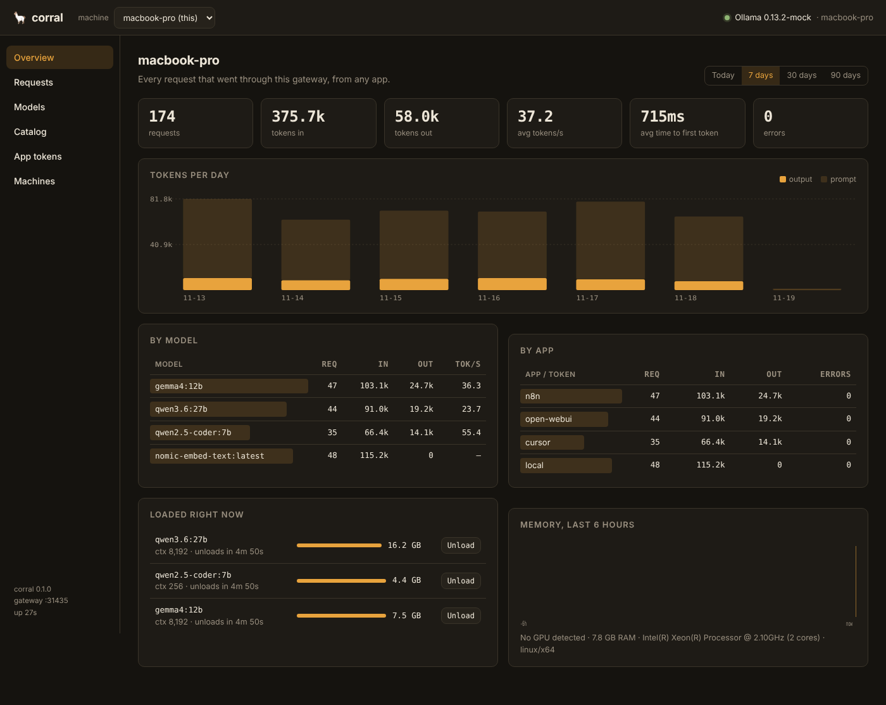
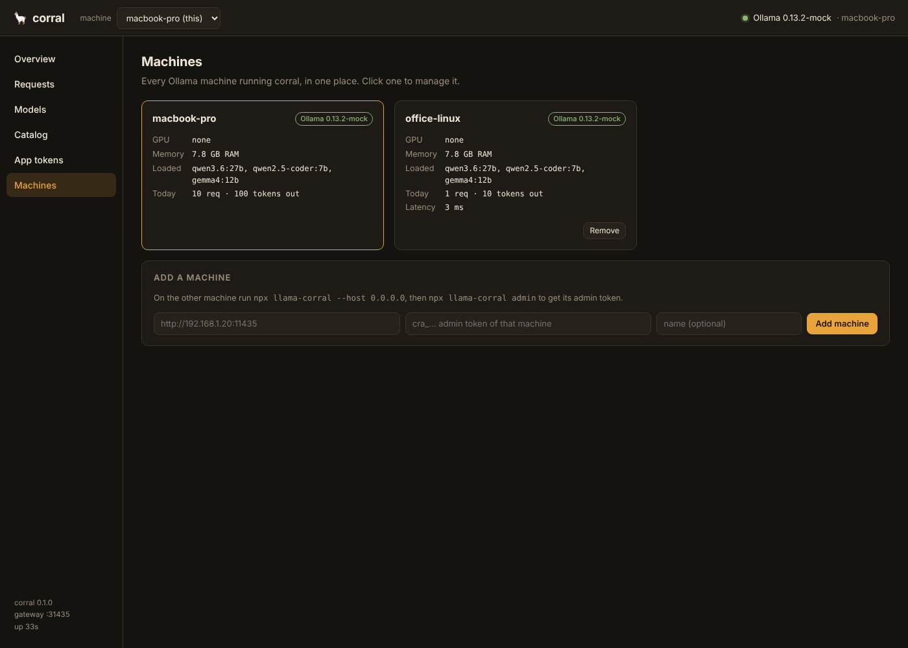

# 🦙 corral

**The control plane for your Ollama machines. Keep your chat UI.**

Corral sits in front of Ollama as a small gateway. Every app you use (Open WebUI, Cursor, Continue, n8n, scripts)
talks to Corral instead of `:11434`, and you get what Ollama doesn't give you:

- **Usage from every app**: requests, tokens in/out, tokens/s and time-to-first-token per model, per app, per day
- **App tokens**: one revocable token per app. Ollama stays on localhost and is never exposed
- **Context-overflow alerts**: see when an app's prompts fill the context window and Ollama silently drops content
- **Model management**: install with progress/ETA, delete, unload, Model Factory (custom system prompt), update detection
- **Catalog with "will it fit"**: 92 current models, with every size colored for *your* GPU/RAM
- **Multiple machines**: add your other Ollama boxes and manage them all from one dashboard

Zero dependencies. One `npx` command. MIT.



## Quick start

Requires Node.js 22.13+ and a running Ollama.

```bash
npx llama-corral
```

It prints a dashboard link (with your admin token). Then point your apps at `http://localhost:11435`.
Requests from the same machine work without a token.

To serve other machines on your network:

```bash
npx llama-corral --host 0.0.0.0
npx llama-corral token create open-webui     # one token per app
```

## Connect your apps

| App | Setting |
|---|---|
| **Open WebUI** | Settings → Connections → Ollama API → URL `http://<host>:11435`, Key `crl_…` |
| **Cursor / Continue / n8n / any OpenAI-compatible tool** | Base URL `http://<host>:11435/v1`, API key `crl_…` |
| **curl** | `-H "Authorization: Bearer crl_…"` |
| **Apps that can't set headers** | Base URL `http://<host>:11435/t/crl_…` |

Tokens are also accepted as `x-api-key` or as the Basic-auth password.

## Multiple machines

On each Ollama machine:

```bash
npx llama-corral --host 0.0.0.0 --name office-linux
npx llama-corral admin        # prints that machine's admin token
```

Then on your laptop, open **Machines → Add a machine** and paste the URL and admin token.
Every view (usage, models, catalog, tokens) can then switch between machines. Tailscale makes this easy outside your LAN.



## CLI

```
corral [start]                 Start gateway + dashboard
  --port 11435                 Gateway port
  --host 127.0.0.1             Bind address (0.0.0.0 to serve other machines)
  --ollama http://127.0.0.1:11434
  --name <machine name>
  --require-token              Require a token even for local requests
  --data ~/.corral             Where the database and config live
corral token create <name>     Create an app token (shown once)
corral token list
corral token revoke <id|name>
corral admin                   Print the dashboard URL
```

Run it as a service with systemd, launchd or `pm2 start "npx llama-corral --host 0.0.0.0"`.

## Privacy

- Prompts and replies are **never stored**. Corral logs only metadata: time, app, model, token counts, timings, status.
- No telemetry. Nothing leaves your machine.
- Data lives in `~/.corral/corral.db` (SQLite). Requests are kept for 90 days.

## How it works

Corral streams responses through unchanged and reads the final chunk Ollama already sends (`prompt_eval_count`,
`eval_count`, durations). For OpenAI-style streams without a usage block, output tokens are estimated from the chunk count
(marked `~`). Loaded models and memory come from `/api/ps` every 10 seconds. Update detection compares your local
manifest digest with the registry's.

## Roadmap

- Model routing and aliases across machines (`coder` → whichever machine has it loaded)
- Side-by-side and blind A/B model arena, benchmark runner
- Community model ratings from verified usage (via strasy)
- Live catalog updates (Hugging Face GGUF, Ollama library)
- Desktop app (Electron + tray)

## Develop

```bash
npm run mock      # fake Ollama on :11434 for UI work
npm start
npm test          # end-to-end: mock Ollama + two corral instances
```

Not affiliated with Ollama. "Ollama" is a trademark of its owners.

## License

MIT
